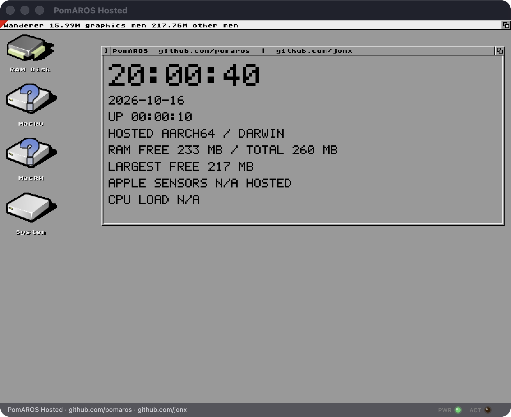

# PomAROS Hosted

PomAROS packages [AROS](https://aros.org), the open-source AmigaOS-compatible
operating system, as a native Apple Silicon Mac application. AROS runs as an
arm64 process, presents the Wanderer desktop in a Cocoa/Metal window, and uses
macOS for display, sound, networking, clipboard, and access to shared files.
New profiles start in a window; fullscreen remains an explicit user choice.

PomAROS is not an emulator for one historic Amiga model. It is a hosted build
of AROS itself, compiled for AArch64 and integrated with the Mac.

PomAROS Hosted is the macOS process target in the PomAROS family. QEMU,
Apple Virtualization.framework, Apple Silicon native, and Raspberry Pi targets
share the AROS source architecture; hosted keeps its Darwin adaptation and
reserves Apple's `x18` register. Their platform binaries are distinct.



## Migration status

The selected common-core pin passes the configured boot/desktop build,
reserved-x18 compiler-runtime checks, strict deployment identity checks, and
windowed desktop startup/input qualification. LLDB attachment before the first
instruction and live inspection are exercised separately; continued operation
after debugger detach is not qualified. Application, media and release coverage
are separate gates. The archived development-app observations below retain their
original source identities.

This repository has been renamed to PomAROS Hosted. No PomAROS release has been
published yet; earlier version and signing notes describe the inherited product.
The rebuilt development app has passed windowed startup, host file exchange,
CoreAudio playback, network and 68k library initialization, and clean shutdown.
The screenshot shows the real Wanderer desktop and the shared monitor renderer,
with live AROS clock, uptime, and memory measurements. Apple hardware sensors
are explicitly unavailable in hosted mode. Broader desktop interaction and the
bundled third-party applications still need separate release qualification.
Build from source with [GETTING-STARTED.md](GETTING-STARTED.md). The product
repository is [pomaros/pomaros-hosted](https://github.com/pomaros/pomaros-hosted).

Release changes are recorded in [CHANGELOG.md](CHANGELOG.md), with the complete
scope and developer ABI requirements in [RELEASE-NOTES.md](RELEASE-NOTES.md).

## What it can do

- Boot the full Wanderer desktop in a resizable native window.
- Exchange clipboard contents with macOS.
- Play audio through CoreAudio and use the Mac's network connection.
- Mount `~/AROS/Shared` as writable `MacRW:` and read-only `MacRO:` volumes.
- Decode common media formats and accelerate the display path with Metal.
- Run native AArch64 AROS applications. Zed and Ferail remain optional
  development payloads pending distribution qualification.
- Run a growing set of classic 68k applications through the included JIT.
- Be driven and inspected without a person at the keyboard through `aros-ctl`.

The default core distribution includes the desktop and host bridges. It excludes
Zed, Ferail, FFmpeg media applications, Rust extras, and Moonstone assets.
Optional application distributions require their own source and dependency
qualification; see [RELEASE.md](RELEASE.md).

## Current limitations

- Source builds produce a development app with an unsigned outer bundle. Its
  embedded engine and bridges are ad-hoc signed; a signed PomAROS release image
  has not been qualified.
- Ferail is at an early stage. Its file-management views work, but it cannot yet
  launch programs or open files by double-clicking them. Launch applications
  from Wanderer or the AROS Shell instead.
- Legacy 68k support is also early and incomplete. Confirmed programs such as
  LhA work, but compatibility varies and programs that depend on unimplemented
  operating-system calls or classic Amiga hardware may fail. Use **Help -> Show
  Reports** after a failure to collect the bounded local compatibility report.
- Self-contained core candidates use Developer ID signing and hardened runtime
  for the complete host layer. Retain their Apple notarization reports with
  each artifact. Public redistribution still requires the corresponding source
  and licence materials for every included copyleft component.

## Repository boundary

This repository owns the PomAROS product and integration layer:

```
graft/       build, deployment, control, compatibility, and release tools
harness/     unattended QEMU and hosted test harnesses
hosted/      macOS host bridges, AROS-side integration experiments, and JIT
docs/        current feature docs, project records, and the initial bring-up archive
```

The original standalone QEMU kernel and Phase 1/Phase 2 notes now live under
[`docs/hosted/initial-platform-bringup/`](docs/hosted/initial-platform-bringup/README.md).
They are retained as a working reference for adding AROS support to another
platform, not as the current PomAROS implementation plan.

The source projects remain separate so their histories and responsibilities do
not become tangled:

- [`aros-core`](https://github.com/pomaros/aros-core) is the public shared operating-system source; `CORE.lock` records
  its repository, branch, and tested revision.
- [jonx/AROS-AArch64](https://github.com/jonx/AROS-AArch64) is retained as a
  redirect to this repository so old links and history remain understandable.
- [jonx/zed-aros](https://github.com/jonx/zed-aros) and
  [jonx/Ferail](https://github.com/jonx/Ferail) develop the bundled apps.

Do not publish changes to the AROS upstream project without first discussing
the exact change with John and receiving explicit approval. This rule is also
recorded in [AGENTS.md](AGENTS.md) for future work in this checkout.

For a concise document to give existing collaborators after the repository
split, see [docs/project/COLLABORATOR-GUIDE.md](docs/project/COLLABORATOR-GUIDE.md).

## Requirements

- An Apple Silicon Mac
- macOS 12 or newer
- Xcode Command Line Tools and Homebrew
- A sibling shared AROS checkout at the revision in `CORE.lock`

The complete source-build path is in
[GETTING-STARTED.md](GETTING-STARTED.md). A typical checkout layout is:

```text
Source/
├── pomaros-hosted/
├── aros-core/    shared AROS source at CORE.lock revision
├── zed-aros/
└── Ferail/
```

Code built for this hosted target must not use Apple platform register `x18`.
Use `-ffixed-x18` for C/C++, the checked-in Rust target with `+reserve-x18`, and
avoid `x18` in assembly. [RELEASE-NOTES.md](RELEASE-NOTES.md) explains the
Darwin signal/preemption failure that makes this mandatory.

With the pinned common source and preserved AROS toolchain available,
`make pomaros-hosted` rebuilds the hosted runtime, host bridges, and development
app. `make pomaros-hosted-check` runs the host bridge checks. The development
app references the stable external build tree; release packaging embeds it.

For incremental bridge changes, the principal commands are:

```sh
make cocoametal-dylib pasteboard-dylib coreaudio-dylib bsdsock-dylib
graft/aros-ctl deploy
AROS_CTL_STARTUP_MODE=desktop graft/run-window.sh
graft/make-aros-app.sh
```

The unattended controller can then boot, type, click, capture the framebuffer,
and inspect the guest:

```sh
graft/aros-ctl run
graft/aros-ctl wait 3
graft/aros-ctl type "echo hello"
graft/aros-ctl enter
graft/aros-ctl shot
graft/aros-ctl stop
```

## Building a release candidate

The release process is documented in [RELEASE.md](RELEASE.md). To create an
unsigned internal candidate:

```sh
graft/set-release-version 0.2.2 1
graft/make-aros-release.sh --dmg
```

`VERSION` at the repository root is the single release identity used by the
bundle, About window, disk image, and build manifest. Increase the build number
when rebuilding the same public version.

The disk image includes a short README and a double-clickable compatibility
checker. Signing, notarization, and publishing are separate steps and happen
only after the exact unsigned candidate has been tested.

## Security and licences

PomAROS is experimental systems software. Review [SECURITY.md](SECURITY.md)
before exposing important data through a writable shared volume.

The integration code is distributed under the AROS Public License 1.1; bundled
projects and dependencies retain their own licences. See [LICENSE](LICENSE),
[THIRD-PARTY-NOTICES.md](THIRD-PARTY-NOTICES.md), and the generated material in
`notices/`.

For source-build qualification scope, see [Migration status](#migration-status).
